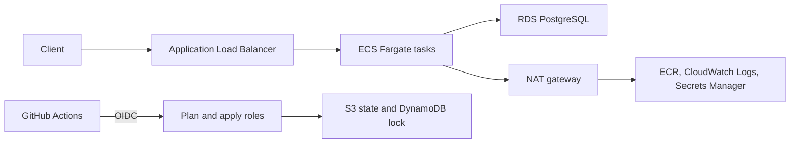

# AWS workload portfolio

**Charles Mphahlele** · Senior DevOps Engineer · Johannesburg, South Africa

[LinkedIn](https://www.linkedin.com/in/charles-mphahlele-b029791b4) · [charlesmphahlele5@gmail.com](mailto:charlesmphahlele5@gmail.com)

This repository is a small AWS platform a client can read end to end. Terraform builds a VPC, an Application Load Balancer, an ECS Fargate service and a private PostgreSQL database, with remote state, a lock table and GitHub Actions roles that assume AWS through OIDC. Development stays cheap. Production refuses to plan unless it has three zones, a NAT gateway per zone, Multi-AZ, deletion protection, access logs and a certificate. Nothing here has been applied. `make check` formats, validates, lints, tests and scans without creating a resource or spending money.

## Architecture



The tasks sit in private subnets. The load balancer is the only public entry. RDS generates the master password and stores it in Secrets Manager. The task execution role reads that secret. The password is not a Terraform variable.

| Path | What it is |
| --- | --- |
| `infrastructure/bootstrap` | State bucket, lock table, state KMS key, GitHub OIDC roles. First apply uses local state. |
| `infrastructure/modules/workload` | Composes KMS, VPC, security groups, IAM, RDS and the ECS service. |
| `infrastructure/environments/dev` | Two zones, one NAT gateway, Fargate Spot, single-AZ `db.t3.micro`. |
| `infrastructure/environments/staging` | Same shape as dev, with flow logs and access logs. |
| `infrastructure/environments/prod` | Three zones, NAT per zone, on-demand Fargate, Multi-AZ `db.t3.medium`, certificate required. |
| `apps/api` | The image the service runs. Flask, gunicorn, Postgres. |
| `apps/multi-container-app` | Local nginx and API lab. Not deployed by Terraform. |
| `apps/observability-stack` | Local Prometheus and Grafana lab. Not deployed by Terraform. |

Design notes are in [docs/adr](docs/adr).

## Prerequisites

For the no-spend check:

- Terraform 1.17.x
- tflint 0.65.x
- Trivy 0.76.x
- gitleaks 8.30.x
- Python 3.12
- GNU Make

Applying also needs an AWS account, the AWS CLI, and permission to create the bootstrap resources. The example region is `af-south-1`.

## Quick start

This does not call AWS and does not spend money.

```bash
make check
```

`make check` runs `terraform fmt -check`, `terraform validate` with `-backend=false`, tflint, `terraform test`, the API unit tests, Trivy config, Trivy vulnerability scan, Checkov and gitleaks.

To run the API on your machine:

```bash
cd apps/api
cp .env.example .env
docker compose up --build
```

`.env` is gitignored. The example password is a local placeholder.

## What an apply costs

Prices below are on-demand, af-south-1, 730 hours in a month, before VAT. Dev is configured for Fargate Spot. The table uses the on-demand price so the figure is a downside, not a hope. Data processing, load-balancer capacity units, flow-log ingestion and enhanced monitoring are excluded because they depend on traffic. Confirm the total in the AWS Pricing Calculator before you apply.

| Item | Rate used | Dev | Prod |
| --- | --- | --- | --- |
| NAT gateway, hourly | $0.057 per hour | 1 × 730 × 0.057 = $41.61 | 3 × $41.61 = $124.83 |
| Public IPv4 | $0.005 per hour | 3 × 730 × 0.005 = $10.95 | 6 × $3.65 = $21.90 |
| Application Load Balancer, hourly | $0.030 per hour | $21.90 | $21.90 |
| Fargate, on-demand | $0.0546 per vCPU-hour, $0.006 per GB-hour | 0.25 vCPU and 0.5 GB = $12.15 | 1 vCPU and 2 GB × 3 tasks = $145.85 |
| RDS PostgreSQL | micro single-AZ $0.024 per hour; medium Multi-AZ $0.186 per hour | $17.52 | $135.78 |
| gp3 storage, 20 GiB | $0.151 per GB-month single-AZ; $0.302 Multi-AZ | $3.02 | $6.04 |
| Customer managed KMS key | $1 per key per month | $1.00 | $1.00 |
| Secrets Manager secret | $0.40 per secret per month | $0.40 | $0.40 |
| Workload subtotal | | $108.55 | $457.70 |
| Shared state KMS key | $1 per month, once | $1.00 | included once if both run |

One environment: dev **$109.55 USD** (about **R1,821.72**) or prod **$458.70 USD** (about **R7,627.77**). Both together, counting the state key once: **$567.25 USD** (about **R9,432.86**).

Sources, fetched 27 October 2026:

- NAT hourly charge for Cape Town, AWS Pricing Calculator metered unit map `natgateway.json`. The per-GB charge is also $0.057 and is not in the total.
- Public IPv4 in-use address, Amazon VPC price list published 16 October 2026, `AFS1-PublicIPv4:InUseAddress`. One address for each NAT gateway, plus one per zone for the internet-facing load balancer.
- Application Load Balancer hourly charge, AWSELB price list published 11 September 2026. LCU price $0.0095 per LCU-hour is excluded.
- Fargate Linux/x86, Amazon ECS price list published 19 October 2026.
- RDS PostgreSQL and gp3, Amazon RDS price list published 26 October 2026. Backup storage inside the provisioned size is treated as included.
- KMS, price list published 26 October 2026. Secrets Manager, price list published 11 September 2026.
- Exchange rate, Frankfurter (ECB), 26 October 2026: 1 USD = 16.6291 ZAR. The 27 October rate was not published when this was written.

Backup window is 03:00–04:00 UTC (05:00–06:00 SAST). Maintenance is Monday 04:00–05:00 UTC (06:00–07:00 SAST).

## Apply and tear down

Applying creates billable resources. Read the cost table first. The steps are in [docs/oidc-aws-setup.md](docs/oidc-aws-setup.md) and [docs/github-actions-setup.md](docs/github-actions-setup.md).

Tear down in this order. Destroy every environment before bootstrap, because the environments store state in the bootstrap bucket.

1. In each environment you applied, from prod back to dev: `terraform destroy`. Prod has deletion protection on the database and the load balancer, and `prevent_destroy` on the workload KMS key. Turn deletion protection off, remove `prevent_destroy` from the key in a reviewed change, apply, then destroy. Prod also keeps a final snapshot.
2. Empty the state bucket, including old versions. DynamoDB deletion protection and `prevent_destroy` on the bucket, the lock table and the state key block a casual destroy. Remove those guards in a reviewed change, apply, then `terraform destroy` in `infrastructure/bootstrap`.
3. Customer managed keys wait for their deletion window (7 days outside prod, 30 days in prod and for the state key).

## Security notes

- No long-lived AWS keys. GitHub Actions assumes a role with OIDC. Apply roles trust a GitHub environment (`dev`, `staging`, `prod`), so apply can require a reviewer.
- State, RDS, ECR, CloudWatch Logs and Secrets Manager use a customer managed key. S3 buckets deny non-TLS. RDS sets `rds.force_ssl=1`. The task sets `sslmode=require`.
- Security groups have no inline rules, so the provider does not add an allow-all egress. Tasks may open 443 to the internet for AWS APIs through the NAT gateway. Interface VPC endpoints were left out on cost.
- The plan role can write the state object. That is the residual risk of letting pull requests plan. See [ADR 003](docs/adr/003-secrets-and-oidc.md).
- Scanners are Trivy, Checkov and gitleaks. Waivers sit on the resource, with the reason, and are listed in [ADR 004](docs/adr/004-security-scanning.md).
- This is not an official AWS Well-Architected review. A short self-review is in [SECURITY.md](SECURITY.md).

## Skills this repository demonstrates

- Terraform modules with pinned providers, validated variables, remote state and locking
- A three-tier AWS workload: private tasks, a public load balancer, encrypted PostgreSQL
- GitHub OIDC to AWS, environment-scoped apply, and least-privilege workflow permissions
- A pipeline that formats, validates, lints, tests and scans, and that stays cheap until plan and apply are switched on
- Cost-aware defaults: Spot and one NAT gateway in dev, Multi-AZ and a certificate in prod

Certifications stated on the profile, and not re-verified by this repository: AWS Certified Solutions Architect – Associate, AWS Certified Developer – Associate, AWS Certified Cloud Practitioner.

Kubernetes, Azure and a multi-account landing zone are not in this repository.

## Licence

[MIT](LICENSE). Copyright 2026 Charles Mphahlele.
